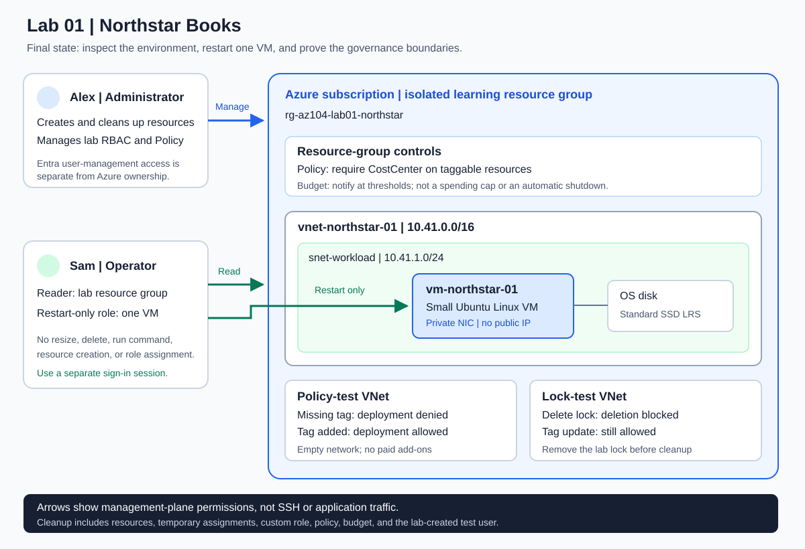

<div dir="rtl" align="right">

# מעבדה <bdi dir="ltr">01</bdi> — מפעיל מכונה עם הרשאות מצומצמות: הרשאות, ממשל ובקרת עלויות

[לגרסה באנגלית](./lab-01-vm-rbac-governance.md)

> **המשימה:** לאפשר למפעיל להפעיל מחדש מכונה וירטואלית אחת, בלי לאפשר לו לשנות את הגדרותיה, לנהל הרשאות או לשנות משאבים אחרים.

| פרטי המעבדה | התוכנית |
| ---: | ---: |
| הסיפור | חברת <bdi dir="ltr">Northstar Books</bdi> מכינה את סביבת <bdi dir="ltr">Azure</bdi> הראשונה שלה |
| קהל היעד | לומדי <bdi dir="ltr">AZ-104</bdi> המשתמשים במנוי <bdi dir="ltr">Azure</bdi> אישי |
| זמן עבודה פעיל | כשעתיים עד שלוש; פריסה והפצת הרשאות עשויות להוסיף זמן המתנה |
| הכלים העיקריים | פורטל <bdi dir="ltr">Azure</bdi> ומרכז הניהול של <bdi dir="ltr">Microsoft Entra</bdi> |
| פרופיל העלות | מכונת <bdi dir="ltr">Linux</bdi> קטנה ודיסק מערכת ההפעלה שלה; ללא כתובת ציבורית, <bdi dir="ltr">Bastion</bdi> או ניטור בתשלום |
| התוצרים | טבלת הרשאות שנבדקה, דחייה בעקבות מדיניות, הדגמת נעילה ורשימת בדיקות לבקרת עלויות |
| מחזור הלמידה | חיזוי, הקמה, אימות, יצירת תקלה מבוקרת, אבחון, שחזור וניקוי |

## הסיפור

<bdi dir="ltr">Northstar Books</bdi> היא חברה קטנה ודמיונית שמעבירה את יישום ניהול המלאי הפנימי שלה ל־<bdi dir="ltr">Azure</bdi>. היום לא תתקינו את היישום עצמו. תכינו את התשתית ותוכיחו שמודל התפעול שלה בטוח.

תמלאו שני תפקידים, באמצעות חלונות או פרופילי דפדפן נפרדים:

- **אלכס, מנהל הסביבה:** יוצר משאבים, מנהל הרשאות ואחראי לניקוי.
- **סם, מפעיל הסביבה:** צריך לבדוק את סביבת המעבדה ולהפעיל מחדש את מכונת המלאי כאשר הוא מתבקש.

צוות הכספים דורש תגית <bdi dir="ltr">`CostCenter`</bdi> והתראה על הוצאות. אלכס רוצה גם להבין מפני מה נעילת משאב מגינה, במקום להניח שהיא הופכת את הסביבה לקריאה בלבד.

ההצעה הראשונית היא להעניק לסם את התפקיד **<bdi dir="ltr">Virtual Machine Contributor</bdi>**. תפקידכם לבדוק מדוע הוא רחב יותר מהדרישה להפעלה מחדש בלבד, ואז להחליפו בתפקיד מותאם אישית בעל תחולה מצומצמת.

### תנאי ההצלחה

- סם יכול לקרוא את המשאבים בקבוצת המשאבים של המעבדה.
- סם יכול להפעיל מחדש את <bdi dir="ltr">`vm-northstar-01`</bdi>.
- סם אינו רשאי לשנות את גודל המכונה, למחוק אותה, להריץ בה פקודות, ליצור מכונה נוספת או להקצות תפקידי <bdi dir="ltr">Azure</bdi>.
- מדיניות המעבדה דוחה יצירת משאב חדש התומך בתגיות כאשר חסרה בו התגית <bdi dir="ltr">`CostCenter`</bdi>.
- נעילה מסוג **<bdi dir="ltr">Delete</bdi>** מונעת מחיקה של משאב בדיקה זמני, אך עדיין מאפשרת לעדכן בו תגית.
- מוגדר תקציב, תוך הבנה שהוא אינו תקרת הוצאה קשיחה.
- כל המשאבים ואובייקטי הזהות הזמניים שנוצרו לתרגיל מוסרים בסיום.

## ארכיטקטורה ומפת הרשאות



התרשים מציג את **מודל ההרשאות הסופי**, ולא את ההקצאה הזמנית של <bdi dir="ltr">Virtual Machine Contributor</bdi> שבה משתמשים בשלב הבדיקה. הכיתובים בתרשים המשותף לשתי הגרסאות הם באנגלית.

- למכונה כרטיס רשת פרטי ברשת וירטואלית מבודדת, ללא כתובת ציבורית או חיבור ניהול נכנס.
- תפעול המכונה נעשה באמצעות מישור הניהול של <bdi dir="ltr">Azure</bdi>. הפעלה מחדש אינה דורשת חיבור <bdi dir="ltr">SSH</bdi>.
- התפקיד <bdi dir="ltr">Reader</bdi> מוקצה לסם ברמת קבוצת המשאבים; התפקיד להפעלה מחדש בלבד מוקצה ברמת המכונה.
- המדיניות והתקציב חלים על קבוצת המשאבים של המעבדה.
- נעילת המחיקה חלה רק על רשת וירטואלית ריקה וזמנית המיועדת לבדיקה.

## 1. הכנה בטוחה

### דרישות מקדימות: הרשאות וזהויות

השתמשו במנוי ובדייר ארגוני — <bdi dir="ltr">Tenant</bdi> — שבשליטתכם, או בסביבת לימוד שאושרה במפורש. אין להשתמש בקבוצת משאבים של סביבת ייצור.

אלכס זקוק להרשאות הבאות:

- יצירת קבוצת משאבים במנוי.
- יצירת משאבים, הקצאת תפקידים, יצירת תפקיד מותאם אישית, הקצאת מדיניות וניהול נעילות בתחולת המעבדה. התפקיד **<bdi dir="ltr">Owner</bdi>** בקבוצת המשאבים החדשה מכסה פעולות ניהול אלה; <bdi dir="ltr">Contributor</bdi> לבדו אינו מספיק.
- יצירה ומחיקה בהמשך של משתמש בדיקה שאינו מנהל ב־<bdi dir="ltr">Microsoft Entra ID</bdi>, למשל באמצעות הקצאה קיימת של **<bdi dir="ltr">User Administrator</bdi>**.
- יצירת תקציב בתחולה שנבחרה; התמיכה והגישה עשויות להשתנות לפי סוג המנוי.

בעלות על מנוי <bdi dir="ltr">Azure</bdi> **אינה** מעניקה באופן אוטומטי הרשאה ליצור משתמשי <bdi dir="ltr">Entra</bdi>. אם אינכם יכולים ליצור את סם, השתמשו בזהות בדיקה ייעודית קיימת בהסכמת בעליה. תעדו שאסור למחוק אותה בזמן הניקוי.

אין להעניק לסם תפקיד מנהל ב־<bdi dir="ltr">Entra</bdi>, תפקיד ברמת המנוי או גישה לסביבת ייצור. אין לשנות לצורך המעבדה את ברירות המחדל של אבטחת הדייר, את האימות הרב־שלבי — <bdi dir="ltr">MFA</bdi> — או את מדיניות הגישה המותנית — <bdi dir="ltr">Conditional Access</bdi>. פעלו לפי דרישות הכניסה והאימות הקיימות.

### תיעוד פרטי המעבדה באופן פרטי

| הגדרה | דוגמה |
| ---: | ---: |
| מנוי | מנוי המעבדה האישי שאימתתם |
| דייר | הספרייה הארגונית המשויכת למנוי |
| אזור | <bdi dir="ltr">`West Europe`</bdi>, או אזור נתמך אחר שתבחרו |
| קבוצת משאבים | <bdi dir="ltr">`rg-az104-lab01-northstar`</bdi> |
| מכונה וירטואלית | <bdi dir="ltr">`vm-northstar-01`</bdi> |
| רשת ותת־רשת | <bdi dir="ltr">`vnet-northstar-01` / `snet-workload`</bdi> |
| רשת לבדיקת המדיניות | <bdi dir="ltr">`vnet-northstar-policytest`</bdi> |
| רשת לבדיקת הנעילה | <bdi dir="ltr">`vnet-northstar-locktest`</bdi> |
| משתמש המפעיל | <bdi dir="ltr">`az104-lab01-sam@<your-tenant-domain>`</bdi> |
| תפקיד מותאם אישית | <bdi dir="ltr">`AZ104 Lab01 VM Restart Operator`</bdi> |
| תגית חובה במשאבים | <bdi dir="ltr">`CostCenter=AZ104-Lab01`</bdi> |
| תגית נוספת במשאבים | <bdi dir="ltr">`Purpose=Learning`</bdi> |

אם שם כבר קיים, בחרו סיומת ייחודית והשתמשו בה באופן עקבי. לעולם אל תמחקו אובייקט קיים כדי לפנות שם.

אין להכניס ל־<bdi dir="ltr">Git</bdi> מזהי מנוי, פרטי משתמשים, סיסמאות או צילומי מסך המכילים מידע אישי. כל שמות החברות ונתוני היישום במעבדה דמיוניים.

### נקודת בדיקה: עלויות

1. פתחו את [מחשבון המחירים של <bdi dir="ltr">Azure</bdi>](https://azure.microsoft.com/pricing/calculator/) ובדקו את מחירי המכונה והדיסק באזור שבחרתם.
2. בחרו גודל קטן וזמין של מכונת <bdi dir="ltr">Linux</bdi> מסדרה המאפשרת התפרצויות ביצועים, למשל <bdi dir="ltr">`Standard_B1s`</bdi>, אם התמונה, האזור והמכסה תומכים בו. אם אינו זמין, השוו חלופות לפני הבחירה.
3. תכננו זמן הפעלה קצר וקבעו תזכורת אישית לניקוי.
4. אין להפעיל בתרגיל <bdi dir="ltr">Backup</bdi>, <bdi dir="ltr">VM Insights</bdi>, תוכניות <bdi dir="ltr">Defender</bdi> בתשלום, <bdi dir="ltr">Bastion</bdi>, <bdi dir="ltr">NAT Gateway</bdi> או כתובת ציבורית.

**מכונה קטנה אינה בהכרח חינמית.** שחרור הקצאת המכונה — <bdi dir="ltr">Deallocation</bdi> — מפסיק את חיובי המחשוב שלה, אך דיסק מערכת ההפעלה ומשאבים אחרים שנשארו עשויים להמשיך לצבור עלויות.

## 2. יצירת קבוצת המשאבים והתקציב

**לפני הלחיצה:** האם תגיות של קבוצת משאבים יופיעו אוטומטית גם במכונה וברשת שלה?

1. התחברו כאלכס ל[פורטל <bdi dir="ltr">Azure</bdi>](https://portal.azure.com).
2. בדקו את **<bdi dir="ltr">Settings > Directories + subscriptions</bdi>**. אמתו את הדייר והמנוי המיועדים.
3. פתחו **<bdi dir="ltr">Resource groups > Create</bdi>**.
4. בחרו את המנוי שאימתתם, את שם קבוצת המשאבים ואת האזור מטבלת ההגדרות.
5. בלשונית **<bdi dir="ltr">Tags</bdi>** הוסיפו <bdi dir="ltr">`CostCenter=AZ104-Lab01`</bdi> ו־<bdi dir="ltr">`Purpose=Learning`</bdi>, וצרו את הקבוצה.
6. בקבוצה פתחו **<bdi dir="ltr">Cost Management > Budgets</bdi>**. אם נתיב זה אינו זמין, פתחו **<bdi dir="ltr">Cost Management</bdi>**, שנו את התחולה לקבוצת המשאבים ובחרו **<bdi dir="ltr">Budgets</bdi>**.
7. צרו את <bdi dir="ltr">`budget-az104-lab01`</bdi> עם סכום חודשי שאתם מוכנים להוציא, במטבע החיוב המוצג. למשל, בחרו סכום של <bdi dir="ltr">`5`</bdi> רק אם אומדן העלות שלכם מתאים לו.
8. השתמשו בתקופה החודשית הנוכחית, בתאריך תפוגה עתידי מתאים ובספי התראה בדוא"ל המבוססים על עלות בפועל, למשל <bdi dir="ltr">50%</bdi>, <bdi dir="ltr">80%</bdi> ו־<bdi dir="ltr">100%</bdi>. השתמשו רק בכתובת ההתראות שלכם.
9. לפני השמירה בדקו את התחולה, הסכום, הספים והנמען.

**אימות:** פתחו שוב את התקציב ובדקו את ההגדרות שנשמרו.

**אם תקציבים אינם נתמכים או אינם זמינים:** תעדו את המגבלה. השתמשו ב־<bdi dir="ltr">Cost Analysis</bdi> בתחולה נגישה, במחשבון ובתזכורת לניקוי. סמנו את תנאי ההצלחה של התקציב כחסום, ולא כשלב שהושלם.

**הסבר:** תגיות קבוצת המשאבים אינן מועתקות אוטומטית למשאבים. תקציבים שולחים התראות; הם אינם עוצרים פריסות או מכבים מכונות. קליטת נתוני עלות והערכת התקציב נעשות בהשהיה. אין להוציא כסף נוסף רק כדי להפעיל התראת דוא"ל.

## 3. פריסת מכונת המלאי ללא חשיפה ציבורית

1. פתחו **<bdi dir="ltr">Virtual networks > Create</bdi>**.
2. בחרו את קבוצת המשאבים והאזור של המעבדה. קראו לרשת <bdi dir="ltr">`vnet-northstar-01`</bdi>.
3. הגדירו מרחב כתובות <bdi dir="ltr">`10.41.0.0/16`</bdi> ותת־רשת <bdi dir="ltr">`snet-workload`</bdi> עם <bdi dir="ltr">`10.41.1.0/24`</bdi>. הסירו או התאימו תתי־רשת ברירת מחדל שיש בהן התנגשות.
4. השאירו כבויים את <bdi dir="ltr">Bastion</bdi>, <bdi dir="ltr">Azure Firewall</bdi>, הגנת <bdi dir="ltr">DDoS</bdi> בתשלום ושירותים אופציונליים אחרים בתשלום.
5. הוסיפו את שתי תגיות המעבדה וצרו את הרשת.
6. פתחו **<bdi dir="ltr">Virtual machines > Create > Azure virtual machine</bdi>**.
7. בחרו את קבוצת המעבדה, את השם <bdi dir="ltr">`vm-northstar-01`</bdi>, את אותו אזור ואת האפשרות **<bdi dir="ltr">No infrastructure redundancy required</bdi>** לתרגיל הזמני.
8. בחרו תמונת <bdi dir="ltr">Ubuntu Server LTS</bdi> זמינה ואת הגודל הקטן שבדקתם במחשבון. שמרו על תצורת אבטחה נתמכת של ברירת המחדל.
9. השתמשו במפתח <bdi dir="ltr">SSH</bdi> ציבורי שבשליטתכם עבור חשבון מנהל המכונה, או צרו מפתח ייעודי למעבדה דרך הפורטל. שמרו כל מפתח פרטי שהורד באופן מאובטח מחוץ לריפו. לא תשתמשו בו להתחברות בתרגיל זה.
10. הגדירו **<bdi dir="ltr">Public inbound ports: None</bdi>**.
11. בלשונית **<bdi dir="ltr">Disks</bdi>** בחרו **<bdi dir="ltr">Standard SSD LRS</bdi>** לדיסק מערכת ההפעלה, ואל תוסיפו דיסקי נתונים.
12. בלשונית **<bdi dir="ltr">Networking</bdi>** בחרו את הרשת ותת־הרשת הקיימות. הגדירו **<bdi dir="ltr">Public IP: None</bdi>**. אם הפורטל יוצר קבוצת אבטחת רשת בסיסית — <bdi dir="ltr">NSG</bdi> — השאירו את הפורטים הציבוריים הנכנסים על **<bdi dir="ltr">None</bdi>**.
13. בלשוניות הניהול והניטור אל תפעילו את השירותים בתשלום שהוחרגו לעיל. ניתן להשאיר אבחון אתחול מנוהל פעיל.
14. הגדירו **<bdi dir="ltr">Auto-shutdown</bdi>** לזמן קצר לאחר סיום המפגש המתוכנן, ובדקו את אזור הזמן. זהו אמצעי זהירות נוסף, ולא תחליף למחיקת המשאבים.
15. הוסיפו את שתי תגיות המעבדה. בדקו את אומדן העלות, סוג הדיסק, הגדרות הרשת והשירותים האופציונליים שנבחרו, ואז צרו את המכונה.

**אימות:**

- הפריסה הסתיימה בהצלחה והמכונה במצב **<bdi dir="ltr">Running</bdi>**.
- למכונה **אין כתובת <bdi dir="ltr">IP</bdi> ציבורית**.
- כרטיס הרשת שלה שייך ל־<bdi dir="ltr">`snet-workload`</bdi>.
- ברשימת המשאבים של הקבוצה מופיעים המכונה, הדיסק, כרטיס הרשת, הרשת וכל <bdi dir="ltr">NSG</bdi> שנוצר.
- בדקו את תגיות המכונה והרשת: הן נוספו במפורש ולא התקבלו בירושה.

**גבולות הרשת:** לא מוסיפים שירות לתעבורה יוצאת, משום שאין צורך בהורדות בתוך מערכת ההפעלה או בפקודות לסוכן המכונה. אל תניחו שלמכונה עם רשת פרטית בלבד יש גישה פעילה לאינטרנט. אין להוסיף שירותי רשת בתשלום רק כדי לבצע בדיקות הפעלה מחדש דרך מישור הניהול.

## 4. יצירת סם ובדיקת תפקידים מובנים

### יצירת סביבת כניסה נפרדת למפעיל

1. כאלכס, פתחו את [מרכז הניהול של <bdi dir="ltr">Microsoft Entra</bdi>](https://entra.microsoft.com).
2. אמתו את הדייר ופתחו **<bdi dir="ltr">Entra ID > Users > New user > Create new user</bdi>**.
3. צרו את המשתמש הייעודי סם לפי טבלת ההגדרות, כמשתמש ענן בלבד. שמרו את הסיסמה הזמנית בסוד, ואל תקצו תפקידי מנהל או רישיונות בתשלום.
4. פתחו פרופיל דפדפן נפרד או חלון גלישה פרטית, והתחברו ל־<bdi dir="ltr">Azure</bdi> כסם.
5. השלימו החלפת סיסמה ורישום אמצעי אימות לפי הדרישות. אמתו את זהות המשתמש המחובר לפני כל בדיקה.
6. לפני הקצאת תפקידים ודאו שאין לסם הרשאות <bdi dir="ltr">Azure</bdi> בירושה דרך הקצאות במנוי או חברות בקבוצות. אלכס יכול לבדוק זאת ב־**<bdi dir="ltr">Access control (IAM) > Check access</bdi>** בקבוצת המשאבים.

אם לסם כבר יש גישה רחבה יותר, השתמשו בזהות בדיקה נקייה. הוספת תפקיד מצומצם אינה מבטלת הרשאה רחבה קיימת.

### בדיקת <bdi dir="ltr">Reader</bdi>, ולאחר מכן <bdi dir="ltr">Virtual Machine Contributor</bdi>

1. כאלכס, פתחו במכונה **<bdi dir="ltr">Access control (IAM) > Add role assignment</bdi>**.
2. הקצו לסם **<bdi dir="ltr">Reader</bdi>** בתחולת המכונה הזו.
3. המתינו להפצת ההרשאות ורעננו את סביבת הכניסה של סם. אם רשימת קבוצת המשאבים אינה זמינה, השתמשו בקישור למכונה בפורטל שהעתיק אלכס.
4. כסם, בדקו את המכונה. בדקו אם **<bdi dir="ltr">Restart</bdi>** אינו זמין או נדחה. אין לבלבל בין כפתור מוסתר לבין בדיקת הרשאה בצד השרת.
5. כאלכס, הסירו רק את הקצאת <bdi dir="ltr">Reader</bdi> ברמת המכונה שנוצרה במעבדה.
6. במקום זאת, הקצו לסם **<bdi dir="ltr">Reader</bdi>** בתחולת **קבוצת המשאבים**.
7. כסם, ודאו שניתן כעת לקרוא את הרשת ואת שאר משאבי הקבוצה, אך עדיין אין הרשאה להפעלה מחדש.
8. כאלכס, הקצו לסם **<bdi dir="ltr">Virtual Machine Contributor</bdi>** בתחולת **המכונה**.
9. כסם, הפעילו מחדש את המכונה והמתינו לסיום הפעולה. אלכס יכול לאמת את ההצלחה ב־**<bdi dir="ltr">VM > Activity log</bdi>**.
10. כאלכס, פתחו את הרשאות התפקיד המובנה בלשונית **<bdi dir="ltr">Roles</bdi>** של ניהול ההרשאות. בדקו את הפעולות המותרות במכונה, כולל פעולות מעבר להפעלה מחדש.

**בשלב בדיקה זה אין למחוק את המכונה, לשנות את גודלה או להריץ בה פקודות.** עיון בהגדרת התפקיד מספיק כדי לזהות את ההרשאות העודפות.

**הסבר:** תחולה ברמת המכונה מגבילה היכן התפקיד חל, אך אינה הופכת את <bdi dir="ltr">Virtual Machine Contributor</bdi> לתפקיד של הפעלה מחדש בלבד. הוא מאפשר לנהל את הגדרות המכונה ולבצע פעולות משמעותיות נוספות. הוא אינו מעניק הרשאה לניהול הקצאות תפקידים ב־<bdi dir="ltr">Azure</bdi>.

## 5. החלפת התפקיד הרחב בתפקיד להפעלה מחדש בלבד

התרגיל כולל בדיקה של תפקיד מותאם אישית. הבנת התפקידים המובנים היא יעד הלימוד המרכזי ב־<bdi dir="ltr">AZ-104</bdi>; התפקיד המצומצם ממחיש בפועל את עקרון ההרשאות המזעריות.

1. כאלכס, **הסירו את הקצאת <bdi dir="ltr">Virtual Machine Contributor</bdi> של סם ברמת המכונה**. השאירו את <bdi dir="ltr">Reader</bdi> ברמת קבוצת המשאבים.
2. פתחו **<bdi dir="ltr">Resource group > Access control (IAM) > Add > Add custom role</bdi>**.
3. בחרו **<bdi dir="ltr">Start from scratch</bdi>**, הזינו את שם התפקיד הייחודי וכתבו תיאור: קריאה והפעלה מחדש של מכונת המעבדה הראשונה, ללא ניהול הגדרות או הרשאות.
4. בלשונית **<bdi dir="ltr">Permissions</bdi>** הוסיפו רק את פעולות הניהול הבאות. השתמשו בחיפוש ספק המשאבים ובדקו היטב את שמות הפעולות שנבחרו:

   <div dir="ltr" align="right">

   ```text
   Microsoft.Compute/virtualMachines/read
   Microsoft.Compute/virtualMachines/instanceView/read
   Microsoft.Compute/virtualMachines/restart/action
   ```

   </div>

5. השאירו את **<bdi dir="ltr">NotActions</bdi>**, **<bdi dir="ltr">DataActions</bdi>** ו־**<bdi dir="ltr">NotDataActions</bdi>** ריקים. אל תוסיפו הרשאות עם תו כללי.
6. בלשונית **<bdi dir="ltr">Assignable scopes</bdi>** השאירו רק את קבוצת המשאבים של המעבדה. אין לכלול את המנוי כולו.
7. לפני יצירת התפקיד בדקו את הגדרתו בפורמט <bdi dir="ltr">JSON</bdi>. ודאו ששלוש הפעולות לעיל הן הפעולות המותרות היחידות.
8. לאחר שההגדרה זמינה, פתחו **<bdi dir="ltr">VM > Access control (IAM)</bdi>** והקצו לסם את התפקיד המותאם אישית בתחולת **המכונה**, ולא בתחולת קבוצת המשאבים.
9. המתינו להפצת ההרשאות. רעננו את סביבת סם או התנתקו והתחברו מחדש לפני בדיקה חוזרת.
10. ודאו שהגישה האפקטיבית של סם כוללת <bdi dir="ltr">Reader</bdi> בקבוצת המשאבים ואת התפקיד המותאם במכונה, ללא הקצאה שנותרה של <bdi dir="ltr">Virtual Machine Contributor</bdi>.

**תחולה זמינה להקצאה אינה הקצאת תפקיד.** היא קובעת היכן ניתן להקצות את התפקיד; ההקצאה עצמה קובעת איזו זהות מקבלת גישה ולאיזה משאב.

### טבלת ההרשאות הסופית

תעדו את התוצאות בפירוט פרטי. לפעולה אסורה בדקו את ההרשאות האפקטיביות או פעולה שאינה זמינה בפורטל; אין לאשר פעולה הרסנית רק כדי לבדוק אותה.

| פעולה כסם | התוצאה הסופית הצפויה | ראיה |
| ---: | ---: | ---: |
| קריאת מאפייני המכונה ומצבה | מותרת | דף סקירת המכונה נטען |
| קריאת רשת העבודה | מותרת | סקירת הרשת נטענת באמצעות <bdi dir="ltr">Reader</bdi> בקבוצת המשאבים |
| הפעלה מחדש של המכונה | מותרת | הפעולה הצליחה ונוצרה רשומה ביומן הפעילות |
| שינוי גודל המכונה | אין הרשאה | אין הרשאת כתיבה במכונה; הפעולה אינה זמינה או מתקבלת דחיית הרשאה |
| מחיקת המכונה | אין הרשאה | אין הרשאת מחיקה במכונה; אין לאשר מחיקה |
| הרצת פקודה במערכת ההפעלה | אין הרשאה | אין הרשאת הרצת פקודות; אין לבצע |
| יצירת מכונה נוספת | אין הרשאה | אין הרשאת כתיבה במכונות ברמת קבוצת המשאבים; אין לשלוח פריסה |
| הוספת הקצאת תפקיד | אין הרשאה | אין הרשאת כתיבה בהקצאות תפקידים; הפעולה בניהול ההרשאות אינה זמינה |
| שינוי רשת וירטואלית | אין הרשאה | <bdi dir="ltr">Reader</bdi> אינו מאפשר כתיבה במשאבי רשת |

לבדיקת דחייה בטוחה בצד השרת, אם **<bdi dir="ltr">Azure CLI</bdi> כבר מותקן**, השתמשו במסוף מקומי ייעודי המחובר כסם. אמתו את הזהות, הדייר והמנוי באמצעות <bdi dir="ltr">`az account show`</bdi>; בחרו את מנוי המעבדה לפי הצורך. לפני ההמשך אלכס חייב לוודא שכל ההקצאות הרחבות הוסרו.

<div dir="ltr" align="right">

```powershell
az vm deallocate --resource-group rg-az104-lab01-northstar --name vm-northstar-01
```

</div>

אם שיניתם את שמות המעבדה, החליפו אותם בפקודה. התוצאה הצפויה היא **<bdi dir="ltr">AuthorizationFailed</bdi>**, משום ששחרור הקצאה אינו נכלל בתפקיד המותאם. אם הפעולה הצליחה באופן בלתי צפוי, הקצאת מכונת המעבדה שוחררה בבטחה: תעדו שציפיית ההרשאה לא התקיימה, בדקו הרשאות אחרות ובקשו מאלכס להפעיל את המכונה שוב. אין לסמן זאת כבדיקת דחייה שעברה בהצלחה.

המסלול העיקרי בפורטל אינו מחייב התקנת כלי שורת פקודה או הקמת <bdi dir="ltr">Cloud Shell</bdi>. אם לא ביצעתם את בדיקת הדחייה האופציונלית, תעדו שהפעולות האסורות נבדקו באמצעות הרשאות אפקטיביות או ממשק המשתמש, ולא באמצעות בקשת <bdi dir="ltr">API</bdi> שנשלחה.

## 6. אכיפת תגית הכספים באמצעות <bdi dir="ltr">Azure Policy</bdi>

**חיזוי:** האם אלכס, בעל תפקיד <bdi dir="ltr">Owner</bdi>, יכול ליצור משאב שמפר מדיניות מוקצית עם אפקט <bdi dir="ltr">Deny</bdi>?

1. כאלכס, פתחו **<bdi dir="ltr">Policy > Definitions</bdi>** וחפשו את ההגדרה המובנית **<bdi dir="ltr">Require a tag on resources</bdi>**.
2. קראו את ההגדרה. ודאו שהיא חלה על משאבים התומכים בתגיות ומשתמשת באפקט <bdi dir="ltr">Deny</bdi>.
3. בחרו **<bdi dir="ltr">Assign</bdi>**, הגדירו תחולה של **קבוצת המעבדה בלבד** וקראו להקצאה <bdi dir="ltr">`policy-lab01-costcenter`</bdi>.
4. הגדירו את פרמטר שם התגית ל־<bdi dir="ltr">`CostCenter`</bdi>. השאירו את האכיפה פעילה. אל תיצרו פטור או זהות מנוהלת להקצאה זו.
5. שמרו והמתינו להפצת ההקצאה. לוח התאימות עשוי להתעדכן מאוחר יותר מהאכיפה.
6. נסו ליצור את <bdi dir="ltr">`vnet-northstar-policytest`</bdi> באותה קבוצה ובאותו אזור, עם מרחב כתובות <bdi dir="ltr">`10.42.0.0/16`</bdi> ותת־רשת <bdi dir="ltr">`10.42.1.0/24`</bdi>, **ללא תגיות כלל**. אל תפעילו שירותים בתשלום.
7. בדקו שגיאות אימות או פריסה. התוצאה הצפויה היא דחייה בעקבות מדיניות, כגון <bdi dir="ltr">`RequestDisallowedByPolicy`</bdi>, המתייחסת לדרישת התגית.
8. אם היצירה הצליחה, תעדו שהדחייה הצפויה לא התרחשה. בדקו תחולה, אכיפה, פרמטרים והפצה. מחקו רק את רשת הבדיקה הריקה הזו, המתינו ונסו שוב.
9. הוסיפו <bdi dir="ltr">`CostCenter=AZ104-Lab01`</bdi> ו־<bdi dir="ltr">`Purpose=Learning`</bdi> לאותה פריסת רשת, ושלחו אותה שוב.
10. ודאו שהרשת עם התגיות נוצרה בהצלחה.

**הסבר:** הרשאות רחבות של <bdi dir="ltr">Owner</bdi> אינן עוקפות מדיניות <bdi dir="ltr">Deny</bdi> פעילה. הגדרה זו מחייבת שהתגית תהיה קיימת; היא **אינה** אוכפת שערכה יהיה <bdi dir="ltr">`AZ104-Lab01`</bdi>. משאבים קיימים אינם מקבלים תגיות אוטומטית, ותגיות הקבוצה אינן תחליף לתגיות המשאב.

## 7. הוכחת התנהגותה של נעילת מחיקה

בצעו סעיף זה כאלכס, כדי שלא לבלבל בין כשל הרשאה של <bdi dir="ltr">Reader</bdi> לבין כשל בגלל נעילה.

1. צרו בקבוצת המעבדה רשת ריקה בשם <bdi dir="ltr">`vnet-northstar-locktest`</bdi>, עם מרחב כתובות <bdi dir="ltr">`10.43.0.0/16`</bdi>, תת־רשת <bdi dir="ltr">`10.43.1.0/24`</bdi> ושתי תגיות המעבדה. אין להפעיל שירותים בתשלום.
2. פתחו **ברשת הזו** את **<bdi dir="ltr">Locks > Add</bdi>**.
3. צרו את <bdi dir="ltr">`lock-lab01-delete`</bdi> עם סוג נעילה **<bdi dir="ltr">Delete</bdi>** — <bdi dir="ltr">`CanNotDelete`</bdi>. אין לבחור <bdi dir="ltr">ReadOnly</bdi>.
4. נסו למחוק **רק את רשת הבדיקה הריקה הזו**, תוך אישור שמה המדויק.
5. ודאו שהנעילה חוסמת את המחיקה, למשל עם השגיאה <bdi dir="ltr">`ScopeLocked`</bdi>.
6. הוסיפו לתגיות אותה רשת את <bdi dir="ltr">`LockTest=UpdateAllowed`</bdi>. השאירו את <bdi dir="ltr">`CostCenter`</bdi> כדי שהמדיניות לא תשפיע על תוצאת הבדיקה.
7. ודאו שעדכון התגית הצליח.
8. הסירו רק את <bdi dir="ltr">`lock-lab01-delete`</bdi>, ואז מחקו רק את <bdi dir="ltr">`vnet-northstar-locktest`</bdi>.
9. ודאו שהרשת נמחקה ושרשת העבודה והמכונה לא השתנו.

**הסבר:** נעילת מחיקה אינה מצב קריאה בלבד, אינה תפקיד הרשאות ואינה בקרת גישה לנתונים. מנהל מורשה חייב להסיר אותה לפני המחיקה. נעילות יכולות גם לעבור בירושה מתחולות אב; בתרגיל זה משתמשים במכוון בנעילה ברמת משאב.

## 8. ההבדל בין עצירה לשחרור הקצאה

1. כאלכס, פתחו את דף **<bdi dir="ltr">Overview</bdi>** של המכונה ובדקו את מצבה הנוכחי.
2. בחרו **<bdi dir="ltr">Stop</bdi>**, אשרו והמתינו למצב **<bdi dir="ltr">Stopped (deallocated)</bdi>**.
3. כסם, בדקו ש־<bdi dir="ltr">Reader</bdi> עדיין מאפשר לצפות במכונה. אל תנסו להשתמש בהרשאת הפעלה מחדש בלבד כתחליף לפעולת **<bdi dir="ltr">Start</bdi>** של המנהל.
4. השאירו את המכונה במצב הקצאה משוחררת עד הניקוי, אלא אם בדיקה אחרת מחייבת שהיא תפעל.

| מצב | משמעות במעבדה |
| ---: | ---: |
| <bdi dir="ltr">Running</bdi> | מחשוב המכונה ומשאבים אחרים שנשארו יכולים לצבור חיובים |
| <bdi dir="ltr">Stopped</bdi>, עדיין מוקצית | כיבוי בתוך מערכת ההפעלה בלבד אינו משחרר את הקצאת המחשוב; חיובי המחשוב ממשיכים |
| <bdi dir="ltr">Stopped (deallocated)</bdi> | הקצאת המחשוב שוחררה; דיסקים ומשאבים אחרים שנשארו עשויים להמשיך לצבור חיובים |
| <bdi dir="ltr">Deleted</bdi> | יש לוודא שגם משאבים נלווים המחויבים בתשלום הוסרו; מחיקת המכונה בלבד יכולה להשאיר משאבים |

כיבוי מתוך מערכת ההפעלה מובא כאן כהשוואה מושגית, ולא כמשימה נוספת: לא הוגדר חיבור למערכת ההפעלה. <bdi dir="ltr">Auto-shutdown</bdi> הוא רשת ביטחון, ותקציב הוא מנגנון התראה אסינכרוני. אף אחד מהם אינו מחליף אימות ניקוי.

## 9. מצב אתגר: אבחנו לפני פתיחת ההסבר

שנו רק משאבים שלכם במעבדה, תנאי אחד בכל פעם. אלכס יחזיר כל שינוי למצב המקורי לפני ההמשך.

### אתגר א׳ — לסם עדיין יש יותר מדי הרשאות

אלכס מוסיף זמנית שוב <bdi dir="ltr">Virtual Machine Contributor</bdi> ברמת המכונה. בלי לבצע פעולות הרסניות, בדקו את הגישה האפקטיבית של סם. הסבירו מדוע תפקיד ההפעלה מחדש אינו מבטל את ההקצאה הרחבה, ואז הסירו את ההקצאה הזמנית.

<details>
<summary>רמז והסבר</summary>

הרשאות <bdi dir="ltr">RBAC</bdi> מצטברות. בדקו הקצאות ישירות והקצאות בירושה, כולל חברות בקבוצות. תפקיד מותאם עם פחות פעולות אינו שולל פעולות שתפקיד אחר מאפשר.

</details>

### אתגר ב׳ — תגיות קבוצת המשאבים לא סיפקו את דרישת המדיניות

לפני שליחת פריסה של רשת בדיקה ללא תגיות, חזו את התוצאה וזהו את התיקון המצומצם ביותר.

<details>
<summary>רמז והסבר</summary>

בדקו את לשונית <bdi dir="ltr">Tags</bdi> של המשאב החדש עצמו. תגיות משאבים אינן עוברות בירושה אוטומטית. הוסיפו לרשת את <bdi dir="ltr">`CostCenter`</bdi>, במקום להעניק הרשאות נוספות או להשבית את המדיניות.

</details>

### אתגר ג׳ — בעל תפקיד <bdi dir="ltr">Owner</bdi> אינו יכול למחוק רשת

הסבירו כיצד תבחינו בין דחייה בגלל נעילה לבין דחייה בגלל הרשאות או מדיניות, באמצעות הראיות שנאספו בסעיף <bdi dir="ltr">7</bdi>.

<details>
<summary>רמז והסבר</summary>

בדקו את קוד השגיאה, נעילות במשאב ובתחולות האב ואת ההרשאות האפקטיביות. השגיאות <bdi dir="ltr">`ScopeLocked`</bdi>, <bdi dir="ltr">`AuthorizationFailed`</bdi> ו־<bdi dir="ltr">`RequestDisallowedByPolicy`</bdi> מצביעות על בקרות שונות. אין להסיר נעילות שאינן שייכות למעבדה.

</details>

## 10. פתרון תקלות

| תסמין | מה לבדוק | צעד בטוח להמשך |
| ---: | ---: | ---: |
| סם אינו רואה את המנוי או המכונה | זהות מחוברת, דייר, מסנן מנויים, תחולת ההקצאה והפצת הרשאות | השתמשו בקישור המכונה של אלכס, רעננו כניסה ובדקו <bdi dir="ltr">Check access</bdi> |
| ההפעלה מחדש עדיין נכשלת | פעולות התפקיד המותאם, תחולת ההקצאה, מצב המכונה ובקרות אחרות | ודאו שקיימת <bdi dir="ltr">`restart/action`</bdi> ונסו שוב רק לאחר הפצת ההרשאות |
| פעולה אסורה מצליחה | הקצאה ישירה ישנה, הקצאה בירושה או הרשאה דרך קבוצה | הסירו רק את הרשאת המעבדה הזמנית; בדקו מחדש בזהות נקייה |
| יצירת תפקיד מותאם אינה זמינה | הרשאות אלכס להגדרות תפקידים והתחולה הזמינה להקצאה | השיגו הרשאות מאושרות או תעדו שהסעיף חסום |
| גודל המכונה אינו זמין | זמינות באזור, מכסת משפחת המכונות ותאימות התמונה | בדקו מחיר של חלופה קטנה נתמכת; אל תגדילו מכסה ללא בדיקה |
| רשת ללא תגיות מתקבלת | תחולת המדיניות, אכיפה, פרמטר התגית והפצת ההקצאה | בדקו את תגיות המשאב בפועל, נקו את הבדיקה, המתינו ונסו שוב |
| התקציב אינו מציג עלויות או אינו שולח דוא"ל | השהיית קליטת שימוש, ספים, תמיכת סוג המנוי ונמען | אמתו הגדרות; לעולם אל תייצרו הוצאה רק כדי להפעיל התראה |
| הניקוי נכשל | נעילות מעבדה שנותרו או תלות במשאבים אחרים | בדקו את השגיאה המדויקת; הסירו רק בקרות שנוצרו במעבדה |

## 11. ראיות ושאלות לסיכום

שמרו תיעוד פרטי של התחזיות, התוצאות בפועל והסברים קצרים. צילומי מסך הם אופציונליים; הסתירו מזהים ופרטים אישיים לפני שיתוף.

- [ ] המכונה פועלת ללא כתובת ציבורית.
- [ ] הושוו הרשאות <bdi dir="ltr">Reader</bdi> ברמת המכונה וברמת קבוצת המשאבים.
- [ ] הוסרה הגישה הזמנית של <bdi dir="ltr">Virtual Machine Contributor</bdi>.
- [ ] הפעלה מחדש מצליחה במצב הסופי עם <bdi dir="ltr">Reader</bdi> והתפקיד המותאם המצומצם.
- [ ] נבדקו הפעולות האסורות במצב הסופי ותועדה שיטת האימות.
- [ ] יצירת רשת ללא תגיות נכשלת, ויצירת רשת עם תגיות מצליחה תחת המדיניות.
- [ ] נעילת מחיקה חוסמת מחיקה אך מאפשרת עדכון תגית.
- [ ] אומתו הגדרות התקציב, או תועד שהוא אינו נתמך או שהשלב חסום.
- [ ] המכונה הגיעה למצב <bdi dir="ltr">Stopped (deallocated)</bdi>.
- [ ] הניקוי המתואר להלן אומת.

ענו בלי להסתכל בהוראות:

1. מדוע <bdi dir="ltr">Virtual Machine Contributor</bdi> רחב מדי עבור מפעיל שצריך רק להפעיל מחדש?
2. מה ההבדל בין תחולות שבהן התפקיד זמין להקצאה לבין תחולת ההקצאה בפועל?
3. מדוע <bdi dir="ltr">Reader</bdi> בקבוצת משאבים חושף יותר משאבים מאותו תפקיד ברמת המכונה?
4. האם <bdi dir="ltr">Owner</bdi> יכול להתעלם ממדיניות <bdi dir="ltr">Deny</bdi> או למחוק דרך נעילת מחיקה?
5. האם המדיניות הזו אוכפת ערך מסוים של תגית?
6. מדוע מכונה עצורה עדיין עשויה לעלות כסף?
7. איזו ראיה מבדילה בין הגבלה בממשק הפורטל לבין דחיית הרשאה בפועל בבקשת <bdi dir="ltr">API</bdi>?

**השלמה פירושה שיש ראיות לתנאי ההצלחה ושהניקוי אומת.** דרישה מקדימה חסומה היא פער לימודי מתועד, ולא תוצאה מוצלחת.

## 12. ניקוי — חובה לפני סיום

בצעו את הניקוי כאלכס. לפני כל מחיקה בדקו שוב את הדייר, המנוי, השמות והבעלות.

1. אם המכונה עדיין פועלת, שחררו את הקצאתה בזמן השלמת הניקוי.
2. הסירו רק את הקצאות התפקידים של סם שנוצרו במעבדה: התפקיד המותאם, <bdi dir="ltr">Reader</bdi> בקבוצת המשאבים וכל הקצאת בדיקה שנותרה.
3. לאחר הסרת ההקצאות, מחקו את <bdi dir="ltr">`AZ104 Lab01 VM Restart Operator`</bdi> מלשונית **<bdi dir="ltr">Roles</bdi>** בניהול ההרשאות של קבוצת המשאבים. הגדרות תפקידים מותאמים אינן משאבי מכונה; אין להניח שמחיקת המכונה מסירה את ההגדרה.
4. מחקו רק את <bdi dir="ltr">`policy-lab01-costcenter`</bdi> מדף **<bdi dir="ltr">Assignments</bdi>** של המדיניות.
5. אם התקציב נוצר, מחקו רק את <bdi dir="ltr">`budget-az104-lab01`</bdi> בתחולה שתיעדתם.
6. הסירו רק נעילה שנותרה בשם <bdi dir="ltr">`lock-lab01-delete`</bdi> ונוצרה בתרגיל.
7. פתחו את קבוצת המשאבים ובדקו את רשימת המשאבים המלאה. ודאו שהיא מכילה רק משאבים שיצרתם לתרגיל.
8. מחקו את קבוצת המשאבים המדויקת הזו באמצעות אישור שמה. אם השתמשתם בקבוצה קיימת בניגוד להנחיות, **אל תמחקו את הקבוצה**; בדקו והסירו רק את משאבי המעבדה שלכם.
9. המתינו לסיום המחיקה. רעננו את **<bdi dir="ltr">Resource groups</bdi>** ואת **<bdi dir="ltr">All resources</bdi>** במנוי שאימתתם. ודאו שמכונת המעבדה, הדיסק, כרטיס הרשת, הרשתות וכל <bdi dir="ltr">NSG</bdi> שנוצר הוסרו.
10. אם סם נוצר למעבדה, מחקו רק את משתמש הבדיקה הזה, שאינו מנהל, ב־<bdi dir="ltr">Entra ID</bdi>. אם זו זהות שהייתה קיימת קודם, השאירו אותה ללא שינוי. התנתקו מחלון הדפדפן של סם.
11. הסירו באופן מאובטח מפתח פרטי ייעודי שהורד למעבדה רק אם אינו בשימוש בשום מקום אחר. לעולם אל תמחקו מפתח אישי קיים.
12. בדקו שוב את <bdi dir="ltr">Cost Analysis</bdi> לאחר שנתוני השימוש יתעדכנו. חיובים היסטוריים יכולים להישאר לאחר מחיקה; ודאו שלא נשארו משאבי מעבדה בתשלום, במקום לצפות שסכום ההוצאות ההיסטורי יתאפס.

**לעולם אל תסירו מדיניות, נעילות, משתמשים, הקצאות תפקידים או משאבים שאינם קשורים למעבדה כדי לאפשר את הניקוי.**

## מקורות וחומרי סדנה קשורים

- [מדריך הבחינה <bdi dir="ltr">AZ-104</bdi>](https://learn.microsoft.com/credentials/certifications/resources/study-guides/az-104)
- [יצירת תפקידים מותאמים בפורטל <bdi dir="ltr">Azure</bdi>](https://learn.microsoft.com/azure/role-based-access-control/custom-roles-portal)
- [תפקידי מחשוב מובנים ב־<bdi dir="ltr">Azure</bdi>](https://learn.microsoft.com/azure/role-based-access-control/built-in-roles/compute)
- [נעילות משאבים ב־<bdi dir="ltr">Azure</bdi>](https://learn.microsoft.com/azure/azure-resource-manager/management/lock-resources)
- [יצירה וניהול של תקציבים](https://learn.microsoft.com/azure/cost-management-billing/costs/tutorial-acm-create-budgets)
- [הדגמות הסדנה בנושא זהויות](../slides/Module%2001%20-%20Identity/Demo-Guide.md)
- [הדגמות הסדנה בנושא ממשל ותאימות](../slides/Module%2002%20-%20Governance%20and%20Compliance/Demo-Guide.md)
- [הדגמות הסדנה בנושא מכונות וירטואליות](../slides/Module%2008%20-%20Administer%20Azure%20Virtual%20Machines/Demo-Guide.md)

שמות האפשרויות בפורטל וזמינות השירותים עשויים להשתנות. אם הניווט שונה, היעזרו בשם המשאב, הפעולה והתחולה כדי לזהות את האפשרות הנכונה. שמות התפקידים, האפשרויות והפקודות נשמרו באנגלית כדי להתאים לממשק ולתיעוד הרשמי.

</div>
