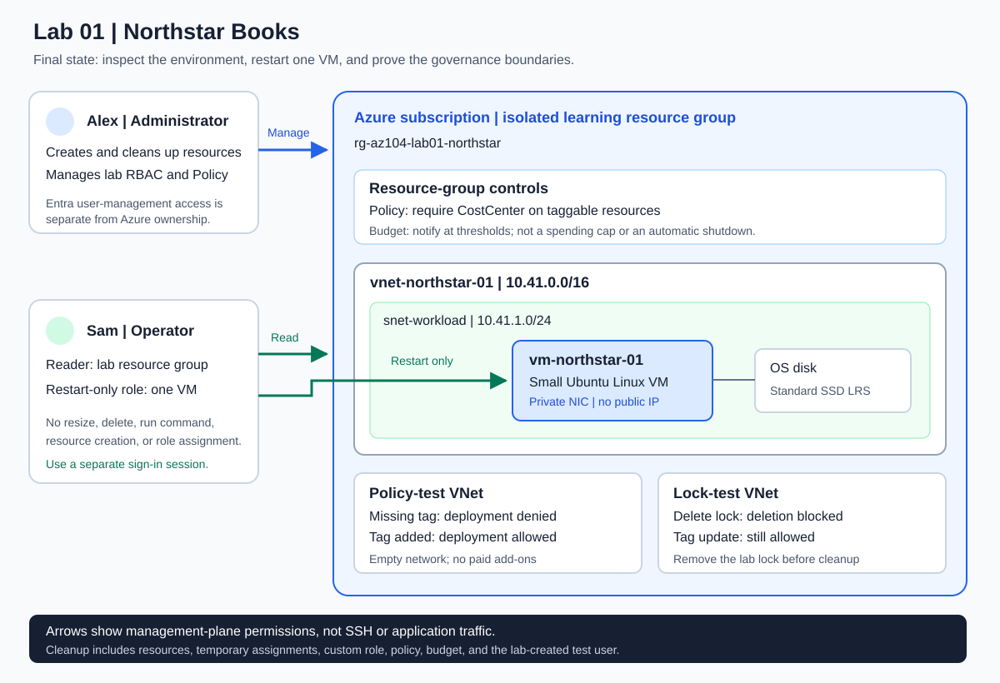

<div dir="ltr" align="left">

# Lab 01 - A Safe VM Operator: RBAC, Governance, and Cost Control

[Hebrew version / גרסה בעברית](./lab-01-vm-rbac-governance.he.md)

> **Mission:** Give an operator permission to restart one VM without giving them permission to change its configuration, manage permissions, or modify other resources.

| Lab detail | Plan |
| --- | --- |
| Story | Northstar Books is preparing its first Azure environment |
| Audience | AZ-104 learner using a personal Azure subscription |
| Active time | Approximately 2-3 hours; deployment and permission propagation can add waiting time |
| Main tools | Azure portal and Microsoft Entra admin center |
| Cost profile | One small Linux VM and its OS disk; no public IP, Bastion, or paid monitoring |
| Outcome | A tested permissions matrix, policy rejection, lock demonstration, and cost-control checklist |
| Learning cycle | Predict -> build -> verify -> break -> diagnose -> recover -> clean up |

## The story

Northstar Books is a fictional small company moving its internal inventory application to Azure. Today, you are not installing that application. You are preparing the infrastructure and proving that its operating model is safe.

You play two people, using separate browser sessions:

- **Alex, the administrator:** creates resources, manages permissions, and owns cleanup.
- **Sam, the operator:** needs to inspect the lab environment and restart the inventory VM when instructed.

The finance team requires a `CostCenter` tag and a spending notification. Alex also wants to understand what a resource lock protects, rather than assuming that it makes the environment read-only.

The initial proposal is to give Sam **Virtual Machine Contributor**. Your job is to investigate why that role is broader than the restart-only requirement, then replace it with a narrowly scoped custom role.

### Acceptance criteria

- Sam can read the resources in the lab resource group.
- Sam can restart `vm-northstar-01`.
- Sam cannot resize, delete, or run commands on that VM, create another VM, or assign Azure roles.
- A new taggable resource without `CostCenter` is rejected by the lab policy.
- A Delete lock prevents deletion of a disposable test resource, but still allows a tag update.
- A budget is configured without pretending it is a hard spending cap.
- All resources and temporary identity objects created for this exercise are removed afterward.

## Architecture and permission map



The diagram shows the **final permission model**, not the temporary Virtual Machine Contributor assignment used during exploration.

- The VM has a private NIC in an isolated VNet, with no public IP or inbound management connection.
- You operate the VM through Azure's management plane. Restarting it does not require SSH access.
- Reader is assigned to Sam at resource-group scope; the restart-only role is assigned at VM scope.
- Policy and budget are scoped to the lab resource group.
- The Delete lock is placed only on an empty, disposable test VNet.

## 1. Prepare safely

### Permissions and identity prerequisites

Use a subscription and tenant you personally control, or an explicitly approved learning environment. Do not use a production resource group.

Alex needs:

- Permission to create a resource group in the subscription.
- Permission to create resources, assign roles, create a custom role, assign policy, and manage locks in the lab scope. **Owner** on the new lab resource group covers these management tasks; Contributor alone does not.
- Permission to create and later delete a non-administrator test user in Microsoft Entra ID, such as an existing **User Administrator** assignment.
- Permission to create a budget at the selected scope; support and access can vary with the subscription offer.

Azure subscription ownership does **not** automatically grant permission to create Entra users. If you cannot create Sam, use a pre-existing, dedicated test identity with its owner's consent. Record that it must not be deleted during cleanup.

Do not grant Sam any Entra administrator role, subscription-level role, or production access. Do not change tenant security defaults, MFA, or Conditional Access for this lab. Follow existing sign-in and MFA requirements.

### Record your lab settings privately

| Setting | Example |
| --- | --- |
| Subscription | Your verified personal lab subscription |
| Tenant | The directory associated with that subscription |
| Region | `West Europe`, or another supported region you choose |
| Resource group | `rg-az104-lab01-northstar` |
| VM | `vm-northstar-01` |
| VNet / subnet | `vnet-northstar-01` / `snet-workload` |
| Policy-test VNet | `vnet-northstar-policytest` |
| Lock-test VNet | `vnet-northstar-locktest` |
| Operator user | `az104-lab01-sam@<your-tenant-domain>` |
| Custom role | `AZ104 Lab01 VM Restart Operator` |
| Required resource tag | `CostCenter=AZ104-Lab01` |
| Additional resource tag | `Purpose=Learning` |

If any name already exists, choose a unique suffix and use it consistently. Never delete an existing object to free a name.

Keep subscription identifiers, user details, passwords, and screenshots containing personal information out of Git. All company names and application data in this lab are fictional.

### Cost checkpoint

1. Open the [Azure pricing calculator](https://azure.microsoft.com/pricing/calculator/) and check your region's VM and disk prices.
2. Select a small available burstable Linux size, for example `Standard_B1s` if the image, region, and quota support it. If unavailable, compare alternatives before choosing one.
3. Plan a short running window and set a personal reminder to clean up.
4. Do not enable Backup, VM Insights, paid Defender plans, Bastion, NAT Gateway, or a public IP for this exercise.

**A VM being small does not make it free.** Deallocation stops VM compute charges, but the OS disk and any other retained billable resources can continue to cost money.

## 2. Create the resource group and budget

**Before you click:** Will tags on a resource group automatically appear on its VM and VNet?

1. Sign in as Alex at the [Azure portal](https://portal.azure.com).
2. Check **Settings > Directories + subscriptions**. Verify the intended tenant and subscription.
3. Open **Resource groups > Create**.
4. Select the verified subscription, resource-group name, and region from your settings table.
5. Add `CostCenter=AZ104-Lab01` and `Purpose=Learning` on **Tags**, then create the group.
6. Open the group's **Cost Management > Budgets**. If that navigation is not available, open **Cost Management**, change its scope to the lab resource group, and select **Budgets**.
7. Create `budget-az104-lab01` with a monthly amount you are comfortable spending, in the displayed billing currency. For example, choose `5` only if your estimates fit that amount.
8. Use the current monthly period, an appropriate future expiration date, and actual-cost email thresholds such as 50%, 80%, and 100%. Use only your own notification address.
9. Review the scope, amount, thresholds, and recipient before saving.

**Verify:** Reopen the budget and inspect the saved settings.

**If budgets are unsupported or unavailable:** Record the limitation. Use Cost Analysis at an accessible scope, the calculator, and your cleanup reminder. Mark the budget acceptance criterion as blocked rather than claiming completion.

**Explain:** Resource-group tags are not automatically copied to resources. Budgets notify; they do not stop deployments or shut down VMs. Cost ingestion and budget evaluation are delayed. Do not spend extra money just to trigger an email.

## 3. Deploy the inventory VM without exposing it

1. Open **Virtual networks > Create**.
2. Select the lab resource group and region. Name the network `vnet-northstar-01`.
3. Configure address space `10.41.0.0/16` and subnet `snet-workload` with `10.41.1.0/24`. Remove or adjust conflicting default subnets.
4. Leave Bastion, Azure Firewall, paid DDoS protection, and other optional paid services off.
5. Add both lab tags and create the VNet.
6. Open **Virtual machines > Create > Azure virtual machine**.
7. Use the lab resource group, `vm-northstar-01`, the same region, and **No infrastructure redundancy required** for this disposable exercise.
8. Select an available Ubuntu Server LTS image and the small size you priced. Keep a supported default security configuration.
9. Use an SSH public key you control for the administrator account, or generate a dedicated lab key through the portal. Store any downloaded private key securely outside this repository. You will not use it to connect during this exercise.
10. Set **Public inbound ports: None**.
11. On **Disks**, select **Standard SSD LRS** for the OS disk and do not add data disks.
12. On **Networking**, select the existing VNet and subnet. Set **Public IP: None**. If the portal creates a basic NSG, leave public inbound ports at **None**.
13. On management and monitoring tabs, do not opt into the paid services excluded above. Managed boot diagnostics can remain enabled.
14. Configure **Auto-shutdown** for a time shortly after your planned session, checking the time zone. Treat this as a backup precaution, not a substitute for deleting resources.
15. Add both lab tags. Review the cost estimate, disk type, networking, and selected optional services, then create.

**Verify:**

- Deployment reports success and the VM is **Running**.
- The VM has **no public IP address**.
- Its NIC belongs to `snet-workload`.
- The resource-group resource list shows the VM, disk, NIC, VNet, and any NSG that was created.
- Inspect tags on the VM and VNet: these were explicitly added, not inherited.

**Networking boundary:** No outbound service is added here because this lab does not need guest downloads or guest-agent commands. Do not assume a private-only VM has working internet egress. Avoid adding paid networking just to complete management-plane restart tests.

## 4. Create Sam and explore built-in RBAC

### Create an isolated operator session

1. As Alex, open the [Microsoft Entra admin center](https://entra.microsoft.com).
2. Verify the tenant, then open **Entra ID > Users > New user > Create new user**.
3. Create the dedicated cloud-only Sam user from your settings table. Keep the temporary password private and assign no administrator roles or paid licenses.
4. Open a separate browser profile or private window and sign in to Azure as Sam.
5. Complete required password changes and authentication registration. Verify the signed-in identity before every test.
6. Before assigning roles, confirm Sam has no inherited Azure access through subscription assignments or group membership. Alex can inspect **Access control (IAM) > Check access** at the lab resource group.

If Sam already has broader access, use a clean test identity. Adding a narrow role does not cancel an existing broad grant.

### Test Reader, then Virtual Machine Contributor

1. As Alex, open **VM > Access control (IAM) > Add role assignment**.
2. Assign **Reader** to Sam at this VM's scope.
3. Allow time for propagation, refresh Sam's session, and use a VM portal link copied by Alex if the resource-group listing is unavailable.
4. As Sam, inspect the VM. Check whether **Restart** is unavailable or denied. Do not mistake a hidden button for a server-side authorization test.
5. As Alex, remove only this lab-created VM-scoped Reader assignment.
6. Assign **Reader** to Sam at **resource-group** scope instead.
7. As Sam, verify the VNet and other group resources are now readable, but restarting the VM remains unauthorized.
8. As Alex, assign **Virtual Machine Contributor** to Sam at **VM** scope.
9. As Sam, restart the VM and wait for the operation to finish. Alex can verify the successful restart under **VM > Activity log**.
10. As Alex, open the built-in role's permissions from IAM's **Roles** tab. Inspect its VM actions, including permissions beyond restart.

**Do not delete, resize, or run commands on the VM during this exploratory phase.** Inspecting the role definition is enough to identify the excessive permissions.

**Explain:** VM scope limits where the role applies, but it does not make Virtual Machine Contributor restart-only. This role can manage VM configuration and perform other powerful VM operations. It does not grant Azure role-assignment administration.

## 5. Replace the broad role with a restart-only role

The requirement includes custom-role exploration. Built-in role interpretation is the main AZ-104 objective; this narrow role makes least privilege concrete.

1. As Alex, **remove Sam's VM-scoped Virtual Machine Contributor assignment**. Keep resource-group Reader.
2. Open **Resource group > Access control (IAM) > Add > Add custom role**.
3. Select **Start from scratch**, enter the unique custom-role name, and describe it as: `Read and restart the Lab 01 VM; no configuration or permission management.`
4. On **Permissions**, add only these management actions. Use the provider search and inspect the selected operation names carefully:

   ```text
   Microsoft.Compute/virtualMachines/read
   Microsoft.Compute/virtualMachines/instanceView/read
   Microsoft.Compute/virtualMachines/restart/action
   ```

5. Leave **NotActions**, **DataActions**, and **NotDataActions** empty. Do not add wildcard permissions.
6. On **Assignable scopes**, keep only the lab resource group. Do not include the entire subscription.
7. Review the role's JSON before creating it. Confirm that the three actions above are the only allowed actions.
8. After the definition becomes available, open **VM > Access control (IAM)** and assign this custom role to Sam at **VM scope**, not resource-group scope.
9. Allow propagation. Refresh or sign out and back in as Sam before retesting.
10. Verify Sam's effective access contains resource-group Reader and the VM-scoped custom role, with no remaining VM Contributor grant.

**Assignable scope is not an assignment.** It determines where the role is available to assign; the role assignment determines which identity receives access and to which resource.

### Final permissions matrix

Record observed results privately. For a forbidden operation, inspect effective permissions or an unavailable portal action; do not confirm a destructive action just to test it.

| Action as Sam | Expected final result | Evidence |
| --- | --- | --- |
| Read VM properties and status | Allowed | VM overview loads |
| Read the workload VNet | Allowed | VNet overview loads through resource-group Reader |
| Restart the VM | Allowed | Successful operation and Activity log entry |
| Resize the VM | Not authorized | No VM write permission; portal action unavailable or authorization rejection |
| Delete the VM | Not authorized | No VM delete permission; do not confirm deletion |
| Run a guest command | Not authorized | No run-command permission; do not execute |
| Create another VM | Not authorized | No VM write permission at resource-group scope; do not submit a deployment |
| Add a role assignment | Not authorized | No role-assignment write permission; IAM action unavailable |
| Modify a VNet | Not authorized | Reader does not permit network writes |

For a safe server-side negative test, if you **already have Azure CLI installed**, use a dedicated local terminal signed in as Sam. Verify the identity, tenant, and subscription with `az account show`; select the lab subscription if needed. Before proceeding, Alex must confirm all broad grants have been removed.

```powershell
az vm deallocate --resource-group rg-az104-lab01-northstar --name vm-northstar-01
```

Substitute your actual lab names if you changed them. Expected result: **AuthorizationFailed**, because deallocation is not in the custom role. If it unexpectedly succeeds, the lab VM is safely deallocated: record the failed permission expectation, investigate other grants, and have Alex start it again. Do not treat this as a passed negative test.

No CLI installation or Cloud Shell deployment is required for the main portal path. Without the optional negative test, record that denied operations were checked through effective permissions/UI rather than a submitted API request.

## 6. Enforce the finance tag with Azure Policy

**Prediction:** Can Alex, as Owner, create a resource that violates an assigned Deny policy?

1. As Alex, open **Policy > Definitions** and search for the built-in **Require a tag on resources**.
2. Read its definition. Confirm it targets taggable resources and uses a Deny effect.
3. Select **Assign**, set the scope to **only the lab resource group**, and name the assignment `policy-lab01-costcenter`.
4. Set the tag-name parameter to `CostCenter`. Leave policy enforcement enabled. Do not create an exemption or a managed identity for this Deny assignment.
5. Save and allow assignment propagation. The compliance dashboard can lag behind enforcement.
6. Attempt to create `vnet-northstar-policytest` in the same group and region, with address space `10.42.0.0/16` and subnet `10.42.1.0/24`, **without any tags**. Enable no paid services.
7. Inspect validation/deployment errors. Expected result: a policy rejection such as `RequestDisallowedByPolicy`, referencing the tag requirement.
8. If it succeeds, record that the expected rejection did not occur. Check scope, enforcement, parameters, and propagation. Delete only that empty test VNet, wait, and retry.
9. Add `CostCenter=AZ104-Lab01` and `Purpose=Learning` to the same VNet deployment, then submit again.
10. Verify the tagged VNet is created successfully.

**Explain:** Owner does not bypass an enforced Deny policy simply by having broad RBAC access. This definition requires the tag's presence; it does **not** enforce that its value equals `AZ104-Lab01`. Existing resources are not automatically retagged, and resource-group tags are not a substitute for resource tags.

## 7. Prove what a Delete lock does

Use Alex for this section so a Reader permission failure cannot be confused with a lock failure.

1. Create an empty `vnet-northstar-locktest` in the lab group with address space `10.43.0.0/16`, subnet `10.43.1.0/24`, and both required lab tags. Enable no paid services.
2. Open **that VNet > Locks > Add**.
3. Create `lock-lab01-delete` with lock type **Delete** (`CanNotDelete`). Do not choose ReadOnly.
4. Attempt to delete **only this empty test VNet**, confirming its exact name.
5. Verify deletion is blocked by the lock, for example with `ScopeLocked`.
6. Update the same VNet's tags with `LockTest=UpdateAllowed`. Keep `CostCenter` present so Policy does not confound the result.
7. Verify the tag update succeeds.
8. Remove only `lock-lab01-delete`, then delete only `vnet-northstar-locktest`.
9. Verify the VNet is gone and the workload VNet and VM are unchanged.

**Explain:** A Delete lock is not read-only, not an RBAC role, and not a data-access control. An authorized administrator must remove it before deletion. Locks can also be inherited from parent scopes; this exercise deliberately uses a resource-level lock.

## 8. Understand stopped versus deallocated

1. As Alex, open the VM's Overview and inspect its current status.
2. Select **Stop**, confirm, and wait until the status is **Stopped (deallocated)**.
3. As Sam, observe that Reader still permits inspecting this VM. Do not attempt to use restart-only access as a substitute for the administrator's Start action.
4. Keep it deallocated until cleanup unless another test requires it running.

| State | What it means for this lab |
| --- | --- |
| Running | VM compute and retained billable resources can incur charges |
| Stopped, still allocated | Guest shutdown alone does not release the compute allocation; compute charges continue |
| Stopped (deallocated) | Compute allocation is released; retained disks and other billable resources can still incur charges |
| Deleted | Verify associated billable resources are also removed; deleting only a VM can leave resources behind |

Guest-OS shutdown is a conceptual comparison here, not an extra task: there is no guest connection configured. Auto-shutdown is a safety net, and a budget is an asynchronous notification mechanism. Neither replaces cleanup verification.

## 9. Challenge mode: diagnose before revealing the explanation

Change only your lab resources, one condition at a time. Have Alex restore each change before continuing.

### Challenge A - "Sam still has too much access"

Alex temporarily adds Virtual Machine Contributor back at VM scope. Without performing destructive operations, inspect Sam's effective access. Explain why the restart-only role does not cancel the broader grant, then remove the temporary assignment.

<details>
<summary>Hint and explanation</summary>

RBAC grants are additive. Review direct and inherited role assignments, including group membership. A custom role with fewer actions does not deny actions granted by another role.

</details>

### Challenge B - "A tagged resource group did not satisfy Policy"

Before submitting an untagged test VNet, predict the outcome and identify the smallest correction.

<details>
<summary>Hint and explanation</summary>

Inspect the new resource's own Tags tab. Resource tags do not inherit automatically. Add the `CostCenter` tag to the VNet, rather than granting more RBAC access or disabling Policy.

</details>

### Challenge C - "Owner cannot delete a VNet"

Explain how you would distinguish a lock rejection from an RBAC or policy rejection, using the evidence collected in section 7.

<details>
<summary>Hint and explanation</summary>

Inspect the error code, Locks at the resource and parent scopes, and effective permissions. `ScopeLocked`, `AuthorizationFailed`, and `RequestDisallowedByPolicy` point to different controls. Do not remove unrelated locks.

</details>

## 10. Troubleshooting

| Symptom | Investigate | Safe next step |
| --- | --- | --- |
| Sam cannot see the subscription or VM | Signed-in identity, tenant, subscription filter, assignment scope, propagation | Use Alex's VM link, refresh sign-in, and inspect Check access |
| Restart still fails | Custom-role actions, VM assignment scope, VM state, other controls | Verify `restart/action` and retry only after propagation |
| A forbidden action succeeds | Old direct assignment, inherited assignment, or group grant | Remove only the temporary lab grant; retest with a clean identity |
| Custom-role creation is unavailable | Alex's role-definition permissions and assignable scope | Obtain approved permissions or record this section as blocked |
| VM size is unavailable | Regional availability, family quota, and image compatibility | Price a supported small alternative; do not blindly raise quota |
| Untagged VNet is accepted | Policy scope, enforcement, tag parameter, and propagation | Inspect actual resource tags, clean up the test, wait, and retry |
| Budget shows no cost or sends no email | Delayed usage ingestion, thresholds, offer support, recipient | Verify configuration; never generate spend solely to force an alert |
| Cleanup fails | Remaining lab locks or other resource dependencies | Inspect the exact error; remove only controls created by this lab |

## 11. Evidence and reflection

Keep a private note with predictions, actual results, and brief explanations. Screenshots are optional; redact identifiers and personal details before sharing anything.

- [ ] VM runs without a public IP.
- [ ] Reader at VM scope and at resource-group scope were compared.
- [ ] Temporary Virtual Machine Contributor access was removed.
- [ ] Final restart succeeds with Reader plus the custom restart-only role.
- [ ] Final forbidden actions were checked, with the verification method recorded.
- [ ] Untagged VNet fails and tagged VNet succeeds under Policy.
- [ ] Delete lock blocks deletion but permits a tag update.
- [ ] Budget settings are verified, or the unsupported/blocked status is documented.
- [ ] VM reaches Stopped (deallocated).
- [ ] Cleanup below is verified.

Answer without looking at the walkthrough:

1. Why is Virtual Machine Contributor too broad for a restart-only operator?
2. What is the difference between a role's assignable scopes and an assignment's scope?
3. Why does Reader at resource-group scope expose more resources than Reader at VM scope?
4. Can Owner ignore a Deny policy or delete through a Delete lock?
5. Does this policy enforce a particular tag value?
6. Why can a stopped VM still cost money?
7. What evidence distinguishes a portal UI restriction from an actual API authorization rejection?

**Done means the acceptance criteria are evidenced and cleanup is verified.** A blocked prerequisite is a recorded learning gap, not a successful result.

## 12. Cleanup - required before you finish

Perform cleanup as Alex. Check tenant, subscription, names, and ownership again before any deletion.

1. If the VM is still running, deallocate it while you complete cleanup.
2. Remove only Sam's lab-created role assignments: the custom role, resource-group Reader, and any leftover exploratory assignments.
3. Delete `AZ104 Lab01 VM Restart Operator` from the resource group's IAM **Roles** tab after its assignments are removed. Custom role definitions are not VM resources; do not assume deleting the VM removes the definition.
4. Delete only `policy-lab01-costcenter` from Policy's **Assignments** page.
5. Delete only `budget-az104-lab01` at its recorded scope if it was created.
6. Remove only any remaining `lock-lab01-delete` lock created in this exercise.
7. Open the lab resource group and inspect the full resource list. Confirm it contains only resources you created for this exercise.
8. Delete that exact resource group by confirming its name. If you used an existing group contrary to the guide, **do not delete the group**; inspect and remove only your individual lab resources.
9. Wait for deletion to complete. Refresh **Resource groups** and **All resources** in the verified subscription. Check that the lab VM, disk, NIC, VNets, and any NSG are gone.
10. If Sam was created for this lab, delete only that non-administrator test user in Entra ID. If Sam was a pre-existing identity, leave it intact. Sign out of Sam's browser session.
11. Securely remove a dedicated downloaded lab private key only if it is no longer used anywhere else. Never delete an existing personal key.
12. Recheck Cost Analysis after usage data catches up. Historical charges can remain after deletion; verify that no billable lab resources remain rather than expecting the historical total to become zero.

**Never remove unrelated policies, locks, users, role assignments, or resources to make cleanup succeed.**

## References and related workshop material

- [AZ-104 study guide](https://learn.microsoft.com/credentials/certifications/resources/study-guides/az-104)
- [Create custom roles in the Azure portal](https://learn.microsoft.com/azure/role-based-access-control/custom-roles-portal)
- [Azure built-in Compute roles](https://learn.microsoft.com/azure/role-based-access-control/built-in-roles/compute)
- [Azure resource locks](https://learn.microsoft.com/azure/azure-resource-manager/management/lock-resources)
- [Create and manage budgets](https://learn.microsoft.com/azure/cost-management-billing/costs/tutorial-acm-create-budgets)
- [Workshop identity demonstrations](../slides/Module%2001%20-%20Identity/Demo-Guide.md)
- [Workshop governance demonstrations](../slides/Module%2002%20-%20Governance%20and%20Compliance/Demo-Guide.md)
- [Workshop VM demonstrations](../slides/Module%2008%20-%20Administer%20Azure%20Virtual%20Machines/Demo-Guide.md)

Portal labels and service availability can change. Use the named resource, action, and scope as the anchor if the navigation differs.

</div>
